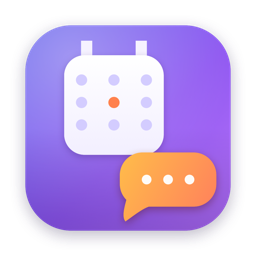
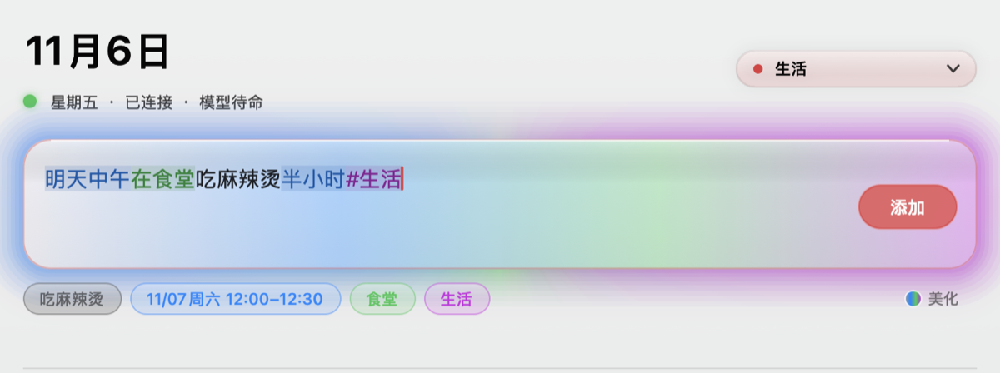

<p align="center">
  <a href="README.md"></a>
  <a href="README.en.md"></a>
</p>

<p align="center">
  
</p>

<h1 align="center">DSH Calendar</h1>

<p align="center">
  Type one sentence, get a calendar event. <b>Time is computed by rules, never guessed by a model.</b><br>
  Works offline, talks to iCloud directly, no server in between.
</p>

<p align="center">
  <a href="https://github.com/zbeabr/dsh-calendar/releases/latest"></a>
  
  
  <a href="https://github.com/zbeabr/dsh-calendar/actions/workflows/ci.yml"></a>
  
</p>

<p align="center">
  
</p>

> **English documentation is not written yet.** The project is developed and documented in Chinese, so the reference material lives in [README.md](README.md). This page covers only what you need to install it and know what it does.
>
> Note that the parser understands **Chinese input only** — that is the product, not a missing translation. Everything below uses Chinese examples on purpose.

---

## Install

Requires macOS 14 or newer. The only dependency is Node.js 18+ ([nodejs.org](https://nodejs.org/en/download)); if it is missing, the app says so on first launch and links you to the download.

1. Download the [latest dmg](https://github.com/zbeabr/dsh-calendar/releases/latest) and open it
2. Drag **DSH 日历** into the Applications folder
3. Launch it

There is no terminal step and no script to run: the app ships with the whole parser inside its bundle and copies it into `~/.local` on first launch.

> **If macOS says the app cannot be verified** — there is no paid Apple Developer account, so it is not notarized. Right-click the app → **Open** → **Open** again. If it claims the app is damaged, run: `xattr -dr com.apple.quarantine "/Applications/DSH 日历.app"`

### Connect your calendar

1. Go to [appleid.apple.com](https://appleid.apple.com) → **Sign-In and Security** → **App-Specific Passwords** → generate one
2. Enter it together with your Apple ID email in the setup window

It must be an **app-specific password** (looks like `abcd-efgh-ijkl-mnop`), not your account password, and two-factor authentication has to be enabled. The password is stored in the system Keychain (service `dsh-cal`) and never written to a config file.

---

## What it understands

| You type (Chinese) | Result |
|---|---|
| `明天下午三点开会` | tomorrow 15:00–16:00, title 开会 |
| `周五下午两点到四点开组会` | Friday 14:00–16:00 |
| `明天中午吃麻辣烫，用半小时` | 12:00–12:30 |
| `明早八点到八点四十在图书馆学高数` | 08:00–08:40, location 图书馆 |
| `明天 洗衣服 #全天` | all-day event, no time |
| `每周一三五 早八 高数` | repeats Mon/Wed/Fri |
| `明天下午三点开会 #学习` | filed into the 学习 calendar |
| `明天下午三点半` / `15:30` / `三点一刻` | all recognised |

Anything unrecognised is reported as an error instead of being guessed. **A wrong date is worse than a refusal.**

## Known limitations

- One event per sentence; multi-line input only uses the first line
- Recurring events show only the next occurrence; "delete just this one" is not implemented
- Events cannot be edited in the GUI (CLI `update` works)
- Location detection relies on prepositions (在/去) or an explicit space — long colloquial sentences may leave the place in the title
- No multi-day events, time zone handling, or lunar calendar
- Not code-signed or notarized

## Other entry points

The same parser is also exposed as a CLI and an MCP server:

```bash
dsh-cal add "明天下午三点开会"      # create
dsh-cal ls                         # list
dsh-cal parse "周五两点到四点开会"   # parse only, no write
dsh-cal doctor                     # check password, connectivity, calendars
```

## License

MIT. Icons and UI are drawn for this project.
