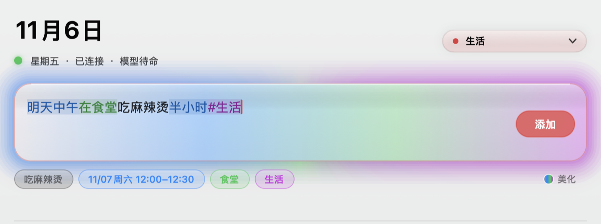
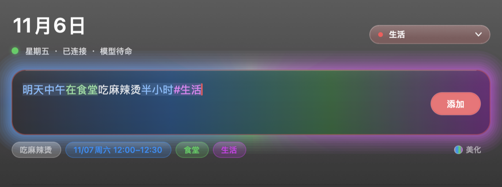

# DSH 日历

**用一句中文建日程。时间由规则算，不靠模型猜；离线可用，直连 iCloud 日历，没有中转服务器。**

<p align="center">
  
</p>

<details>
<summary>深色模式</summary>

<p align="center">
  
</p>

</details>

---

## 它是什么

一个 macOS 原生日历输入器。你在输入框里写人话：

```
明天中午在食堂吃麻辣烫半小时 #生活
```

它当场在下面给出四个胶囊——主题、时间、地点、日历——同时把这句话里的不同成分上色。按回车，日程就写进你的 iCloud 日历里了。

写错了可以直接改，胶囊实时跟着变；和已有日程撞了会提示，但不拦你。同一份解析器另外还提供：

- `dsh-cal` 命令行（`add` / `ls` / `rm` / `parse` / `doctor`）
- MCP 服务（在 Claude、WorkBuddy 等客户端里直接「明天三点开会」）

## 为什么又做一个日历

市面上的做法基本是三种：云端大模型全栈、只做时间解析的库、或者给大模型套一层 MCP 壳。这个项目的取舍不太一样：

| | 这个项目 | 云端 LLM 方案 |
|---|---|---|
| 时间从哪来 | 规则计算，确定 | 模型生成，有概率 |
| 同样的输入 | 永远同一个结果 | 可能不一样 |
| 断网 | 能建，进队列，联网补发 | 用不了 |
| 延迟 | 毫秒（边打字边预览） | 0.6–2.5 秒，只能回车后跑 |
| 数据经过谁 | 只有你的 Mac 和 iCloud | 模型服务商 |
| 依赖 | Node 标准库，零 npm 依赖 | SDK + API Key |

代价我也说清楚：**标题和地点是开放语义，规则做不完美**。所以它会在一个地方不如模型——长句里"哪个词是地点"要靠介词（在/去）或者你自己打个空格。这一点选在「已知限制」里写了。

## 安装

要求：macOS 14 或更新，Node 18+（`brew install node`）。不需要 Xcode，也不需要 npm install。

```bash
git clone https://github.com/zbeabr/dsh-calendar.git dsh-cal
cd dsh-cal
./install.sh
```

脚本会依次做四件事，全部不需要 sudo：

1. 后端装到 `~/.local/share/dsh-cal`
2. 启动器装到 `~/.local/libexec/dsh-cal-run`（GUI 应用的环境变量很干净，由它负责找 node）
3. 命令装到 `~/.local/bin/dsh-cal`
4. 编译并安装 `~/Applications/DSH 日历.app`（arm64 + x86_64 通用二进制）

只想要命令行 / MCP：`./install.sh --cli-only`。卸载：`./uninstall.sh`（只会删本程序自己的文件，你的日程在苹果服务器上，不受影响）。

### 连上你的日历

1. 打开 <https://appleid.apple.com> → **登录与安全** → **App 专用密码** → 生成一个
2. `dsh-cal login`
3. `dsh-cal doctor` —— 能列出你的日历就通了

要的是 **App 专用密码**（形如 `abcd-efgh-ijkl-mnop`），不是 Apple ID 的登录密码，且账号需已开启双重认证。密码存在系统钥匙串（service `dsh-cal`），**不写进任何配置文件**。

## 怎么说话才认得

| 你写 | 结果 |
|---|---|
| `明天下午三点开会` | 11/07 15:00–16:00 开会 |
| `周五下午两点到四点开组会` | 11/07 14:00–16:00 |
| `明天中午吃麻辣烫，用半小时` | 12:00–12:30（时长按你说的算） |
| `明早八点到八点四十在图书馆学高数` | 08:00–08:40，地点「图书馆」 |
| `明天去三教201交作业` | 「去」后面当地点 |
| `下周一上午十点体检 校医院` | 空格隔开的最后一段当地点 |
| `明天 洗衣服 #全天` | 全天日程，不设时间 |
| `每周一三五 早八 高数` | 每周一三五重复 |
| `每月五号 交房租` | 按月重复 |
| `明天下午三点开会 #学习` | 写进「学习」日历 |
| `提前十分钟提醒我` | 日程带提醒 |
| `明天下午三点半` / `15:30` / `三点一刻` | 都认 |

认不出来的会明确报错让你重说，而不是猜一个时间塞进去。**日期错了比报错严重得多。**

## 键盘

| 快捷键 | 作用 |
|---|---|
| `↩` | 添加 |
| `⌘G` | 输入框染色（灰→蓝→绿→紫，顺序跟下面胶囊一致） |
| `⇧⌘G` | 输入框光圈（Apple 智能风格的外圈辉光） |
| `⌘,` | 设置 |
| `⌘R` / `⌥⌘R` | 刷新日程 / 重新加载本地模型 |

## 架构

```
┌──────────────────────────────┐
│  DSH 日历.app (Swift/AppKit) │
│  输入框 · 胶囊 · 列表 · 光圈  │
└──────────────┬───────────────┘
               │ 子进程，JSON 进出
┌──────────────▼───────────────┐        ┌──────────────────┐
│  cli.mjs                     │───────▶│ iCloud CalDAV    │
│   ├─ src/nlp.mjs   规则解析   │  HTTPS │ caldav.icloud.com│
│   ├─ src/caldav.mjs 协议     │        └──────────────────┘
│   ├─ src/store.mjs 配置/钥匙串│
│   └─ src/llm.mjs   可选增强   │───────▶ 本地 Ollama / 任意
└──────────────┬───────────────┘        OpenAI 兼容端点
               │ 同一套函数
        mcp-server.mjs → Claude / WorkBuddy 等 MCP 客户端
```

- **`nlp.mjs` 是纯 ECMAScript**，1097 行，零 import、零 Node API。它同时被 App、CLI、MCP 使用，将来也能直接在浏览器里跑。
- 网络、钥匙串这些平台能力都在 `caldav.mjs` / `store.mjs` 里，和解析逻辑分开。
- 解析器有 **133 条用例**，`npm test` 一条命令跑完，0.12 秒。历史 bug 全部固化成用例（「全天日程被写早一天」「用半小时无效」「区间句的时长烂在标题里」这类）。

## 关于本地模型（可选，默认关闭）

规则是地基，模型只是补丁：它只负责把「标题」和「地点」从剔掉时间后的残句里切出来，**永远不碰时间**。

- 默认不启用。启用方式：设置里填 Ollama 地址（`http://127.0.0.1:11434`）和模型名，或任意 OpenAI 兼容端点。
- 什么时候会问模型：规则标题看着可疑、或者句子里有介词却没解析出地点。其余情况不问。
- 模型给出可疑结果时会整条丢弃、回落规则（比如把「吃杨国福麻辣烫」切成标题「吃」+ 地点「杨国福麻辣烫」）。
- 系统的端上模型（FoundationModels，macOS 26+）已经预留位置，但**中国大陆目前不可用**，代码里按"探到才启用"处理，探测不到就完全不出现。

## 已知限制

诚实清单，这些是当前版本确实做不到的：

- **一句话只建一个日程**，多行输入也只取第一行
- 重复日程在列表里只显示**下一次**发生；还不能"只删这一次"
- 界面上**不能编辑**已有日程（只能删了重建，CLI 的 `update` 可以）
- 地点识别靠介词或空格，纯口语长句可能把地点留在标题里
- 跨天日程、时区切换、农历/节假日还没有
- 没有代码签名和公证：从 Releases 下载的 `.app` 会被 Gatekeeper 拦，需要右键打开，或 `xattr -d com.apple.quarantine`

## 开发

```bash
npm test              # 133 条解析用例（不需要网络）
npm run test:llm      # 需要本地 Ollama，对比规则与模型的输出
cd cal-app && ./build.sh    # 只编译 App
DSH_CAL_ARCHS=arm64 ./build.sh   # 只编本机架构，快一半
```

调试环境变量：`DSH_CAL_DEBUG=1`（打印子进程调用）、`DSH_CAL_GLOW_DEBUG=1`（打印光圈相位）、`DSH_CAL_DEMO_DARK=1 / DSH_CAL_DEMO_LIGHT=1`（强制深/浅色，用于截图）。

## 许可

MIT。图标与界面全部为本项目自绘。
