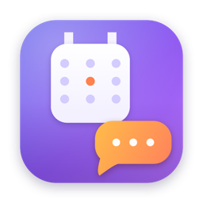
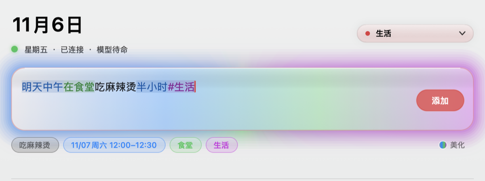
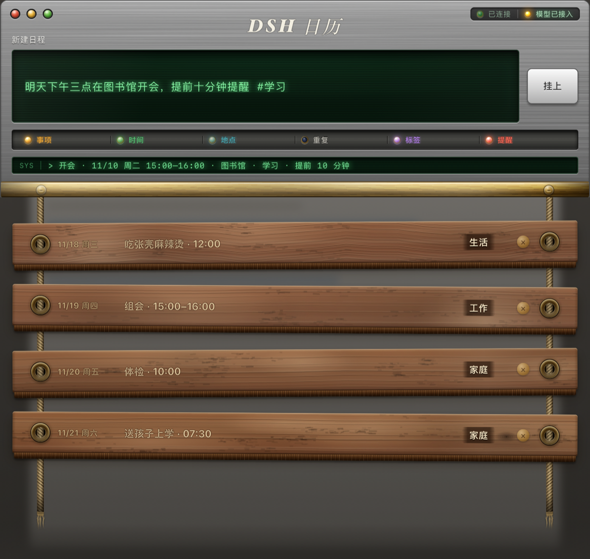
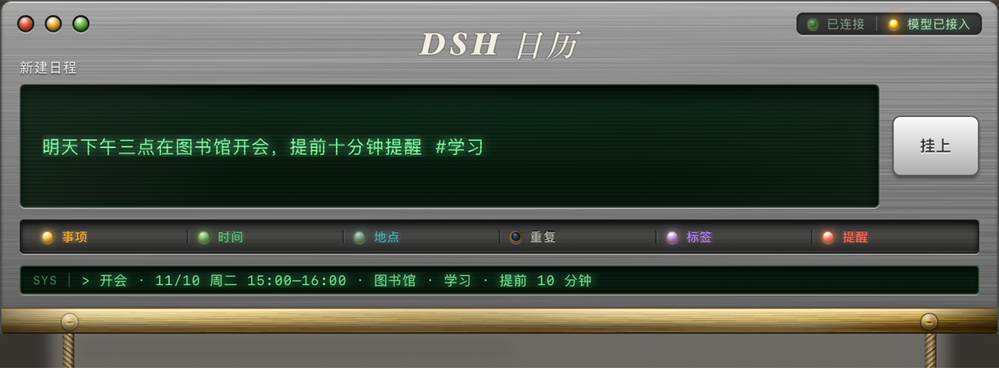

<p align="center">
  <a href="README.md"></a>
  <a href="README.en.md"></a>
</p>

<p align="center">
  
</p>

<h1 align="center">DSH 日历</h1>

<p align="center">
  用一句中文建日程。<b>时间由规则算，不靠模型猜</b>；离线可用，直连 iCloud，没有中转服务器。
</p>

<p align="center">
  <a href="https://github.com/zbeabr/dsh-calendar/releases/latest"></a>
  
  
  <a href="https://github.com/zbeabr/dsh-calendar/actions/workflows/ci.yml"></a>
  
</p>

<p align="center">
  
</p>

---

## 安装

**只需 macOS 14 或更新。** Node.js 18+ 是唯一的依赖，没有就装一个 [nodejs.org](https://nodejs.org/zh-cn/download)，两分钟的事。

1. 下载 [最新版 dmg](https://github.com/zbeabr/dsh-calendar/releases/latest)，双击打开
2. 把「DSH 日历」拖进右边的 Applications 文件夹
3. 打开它

后端不用你操心。App 里带着整套解析器，第一次启动会自己装进 `~/.local`，**不需要开终端，也不需要跑脚本**。万一机器上没有 Node.js，窗口会直接说明并给出下载入口，装好回来点「重新检测」即可。

> **提示「无法验证开发者」时**：没有 Apple 付费开发者账号，所以没做公证。在 App 上右键 →「打开」→ 再点一次「打开」即可。若提示的是「已损坏」，终端执行一行：`xattr -dr com.apple.quarantine "/Applications/DSH 日历.app"`

### 连上你的日历

第一次打开会让你填两样东西：

1. 打开 [appleid.apple.com](https://appleid.apple.com) → **登录与安全** → **App 专用密码** → 生成一个
2. 把它和 Apple ID 邮箱填进窗口

要的是 **App 专用密码**（形如 `abcd-efgh-ijkl-mnop`），不是登录密码，账号需已开启双重认证。密码存进系统钥匙串（service `dsh-cal`），**不写进任何配置文件**。

> **中国大陆的 Apple ID**（数据在云上贵州）：走的是 `caldav.icloud.com.cn`，和国际区是两套后端。
> 不用自己改配置 —— 连不上时程序会自动换到另一个区的入口再试一次，成功之后把地址记进
> `config.json`，`dsh-cal doctor` 里能直接看到这次用的是哪个服务器。
> 两个区都拒绝，那就是密码问题：这里只认 16 位的 App 专用密码。

---

<table>
<tr>
<td width="33%" valign="top">
<h3>时间不用猜</h3>
<p>规则算出来的，不是模型生成的。同一句话永远得到同一个结果，错了也是稳定地错，能查、能修、能补用例。</p>
</td>
<td width="33%" valign="top">
<h3>断网也能建</h3>
<p>解析全在本机。断网时照样建，事件进队列，联网自动补发。数据只经过你的 Mac 和 iCloud。</p>
</td>
<td width="33%" valign="top">
<h3>一个解析器，三个入口</h3>
<p>App、命令行、MCP 共用同一套规则和 200 多条用例，行为不会各说各话。</p>
</td>
</tr>
</table>

## 两种外观

同一个 App，两套界面：默认是上面那张 Liquid Glass；**设置…（`⌘,`）→ 外观 → 全拟物外观** 拨过去，整窗换成黄铜金属板和挂在麻绳上的木板。开关只记偏好 + 换 Dock 图标，回到主界面才生效；两套界面共用同一个解析器和同一份日程数据，来回切不丢东西。

<p align="center">
  
</p>

- **绿磷光屏**：输入区是凿进金属板的老式终端屏，扫过一条条扫描线，字是磷光绿。
- **六色灯阵**：事项 / 时间 / 地点 / 重复 / 标签 / 提醒，六个灯位常驻，认出来哪一项就亮哪一盏 —— 打字时一眼看出「这句被理解成了什么」。玻璃版那排识别标签在这里换成了灯：不用读字，看哪几盏亮就行。
- **SYS 液晶条**：认出什么、写没写成、冲突或离线，都走这条独立小屏，不跟输入挤在一行。
- **木板与麻绳**：一条日程一块木板，穿在两根麻绳上，日期、内容、日历标签写在木头上。
- **会晃**：拖窗口时整串木板按惯性甩起来，冲量沿绳往下传，越靠下的木板摆得越晚、越大；上下抽动窗口也会带动它们（垂直驱动单摆的参数共振），不是只有左右才动。
- **点选即摘**：点一块木板选中，`⌫` 摘下，先弹二次确认 —— 不会点一下就没、没有反悔机会。

<p align="center">
  
</p>

拟物版是单个 HTML（`cal-app/web/skeuo.html`）挂在 `WKWebView` 里，木纹、麻绳、铜件、磷光屏全由 CSS / SVG 画，只有木纹在启动时预烘焙成一张贴图（逐帧算噪声是上一版滚动卡顿的根因）。切外观只换 `contentView`，不重建控件、不碰任何产品状态。

## 怎么说话才认得

| 你写 | 结果 |
|---|---|
| `明天下午三点开会` | 11/07 15:00–16:00 开会 |
| `周五下午两点到四点开组会` | 11/07 14:00–16:00 |
| `明天中午吃麻辣烫，用半小时` | 12:00–12:30（时长按你说的算） |
| `明早八点到八点四十在图书馆学高数` | 08:00–08:40，地点「图书馆」 |
| `明天去三教201交作业` | 「去」后面当地点 |
| `下周一上午十点体检 校医院` | 空格隔开的最后一段当地点 |
| `明天 洗衣服 #全天` | 全天日程，不设时间 |
| `每周一三五 早八 高数` | 每周一三五重复 |
| `每月五号 交房租` | 按月重复 |
| `明天下午三点开会 #学习` | 写进「学习」日历 |
| `提前十分钟提醒我` | 日程带提醒 |
| `明天下午三点半` / `15:30` / `三点一刻` | 都认 |

认不出来的会明确报错让你重说，而不是猜一个时间塞进去。**日期错了比报错严重得多。**

<details>
<summary><b>键盘快捷键</b></summary>

| 快捷键 | 作用 |
|---|---|
| `↩` | 添加 |
| `⌘G` | 输入框染色（灰→蓝→绿→紫，顺序同「标题 → 时间 → 地点 → 标签」） |
| `⇧⌘G` | 输入框光圈（Apple 智能风格的外圈辉光） |
| `⌘,` | 设置 |
| `⌘R` / `⌥⌘R` | 刷新日程 / 重新加载本地模型 |

染色和光圈是玻璃版专属，拟物版没有这两项。

</details>

<details>
<summary><b>为什么不用大模型解析时间</b></summary>

市面上的做法基本是三种：云端大模型全栈、只做时间解析的库、或者给大模型套一层 MCP 壳。这个项目的取舍不太一样：

| | 这个项目 | 云端 LLM 方案 |
|---|---|---|
| 时间从哪来 | 规则计算，确定 | 模型生成，有概率 |
| 同样的输入 | 永远同一个结果 | 可能不一样 |
| 断网 | 能建，进队列，联网补发 | 用不了 |
| 延迟 | 毫秒（边打字边预览） | 0.6–2.5 秒，只能回车后跑 |
| 数据经过谁 | 只有你的 Mac 和 iCloud | 模型服务商 |
| 依赖 | Node 标准库，零 npm 依赖 | SDK + API Key |

代价也说清楚：**标题和地点是开放语义，规则做不完美**。所以它会在一个地方不如模型——长句里「哪个词是地点」要靠介词（在/去）或者你自己打个空格。这一点写在「已知限制」里了。

</details>

<details>
<summary><b>架构</b></summary>

```
┌──────────────────────────────┐
│  DSH 日历.app (Swift/AppKit) │
│  输入框 · 胶囊 · 列表 · 光圈  │
└──────────────┬───────────────┘
               │ 子进程，JSON 进出
┌──────────────▼───────────────┐        ┌──────────────────┐
│  cli.mjs                     │───────▶│ iCloud CalDAV    │
│   ├─ src/nlp.mjs   规则解析   │  HTTPS │ caldav.icloud.com│
│   ├─ src/caldav.mjs 协议     │        └──────────────────┘
│   ├─ src/store.mjs 配置/钥匙串│
│   └─ src/llm.mjs   可选增强   │───────▶ 本地 Ollama / 任意
└──────────────┬───────────────┘        OpenAI 兼容端点
               │ 同一套函数
        mcp-server.mjs → Claude / WorkBuddy 等 MCP 客户端
```

- **`nlp.mjs` 是纯 ECMAScript**，1097 行，零 import、零 Node API。它同时被 App、CLI、MCP 使用，将来也能直接在浏览器里跑。
- 网络、钥匙串这些平台能力都在 `caldav.mjs` / `store.mjs` 里，和解析逻辑分开。
- 解析器有 **202 条用例**，另加 39 条安全/队列用例、13 条账号/区域用例和 31 条 CalDAV 往返用例，`npm test` 一条命令跑完，5 秒左右。历史 bug 全部固化成用例（「全天日程被写早一天」「用半小时无效」「区间句的时长烂在标题里」「改时间改到 VTIMEZONE 上」这类）。
- 后端随 App 一起分发（`Contents/Resources/engine`），首次启动复制到 `~/.local`，所以 App 和命令行永远同版本。
- **拟物外观是另一层 `WKWebView`**，装 `cal-app/web/skeuo.html` 这个单文件，和 AppKit 那套玻璃界面并行、互不依赖；两者只共用 node 后端和「当前是哪种外观」这一个偏好。

</details>

<details>
<summary><b>命令行与 MCP</b></summary>

同一个解析器另外两个入口：

```bash
dsh-cal add "明天下午三点开会"     # 添加
dsh-cal ls                        # 列出
dsh-cal parse "周五两点到四点开会"  # 只看解析结果，不写入
dsh-cal doctor                    # 检查密码、连接、日历
```

在 Claude、WorkBuddy 等 MCP 客户端里注册 `mcp-server.mjs`，就能直接说「明天三点开会」。

</details>

<details>
<summary><b>本地模型（可选，默认关闭）</b></summary>

规则是地基，模型只是补丁：它只负责把「标题」和「地点」从剔掉时间后的残句里切出来，**永远不碰时间**。

- 默认不启用。启用方式：设置里填 Ollama 地址（`http://127.0.0.1:11434`）和模型名，或任意 OpenAI 兼容端点。
- 什么时候会问模型：规则标题看着可疑（含量词残渣、残留时间词、过长），或者句子里有介词却没解析出地点。其余情况不问；「没写地点」本身不再触发模型。
- 模型给出可疑结果时会整条丢弃、回落规则（比如把「吃杨国福麻辣烫」切成标题「吃」+ 地点「杨国福麻辣烫」，或只把标题截短却没补出新信息）。
- 没采纳模型结果时，`node cli.mjs parse "…" --json` 的 `modelNote` 会说明原因（护栏拦下 / 超时 / 没连上），不再静默失败。
- 系统的端上模型（FoundationModels，macOS 26+）已经预留位置，但**中国大陆目前不可用**，代码里按"探到才启用"处理，探测不到就完全不出现。

</details>

<details>
<summary><b>从源码安装</b></summary>

需要 Xcode Command Line Tools 提供 `swiftc`（`xcode-select --install`）。

```bash
git clone https://github.com/zbeabr/dsh-calendar.git dsh-cal
cd dsh-cal
./install.sh
```

脚本会依次把后端装到 `~/.local/share/dsh-cal`、启动器装到 `~/.local/libexec`、命令装到 `~/.local/bin`、App 装到 `~/Applications`，全部不需要 sudo。

只想要命令行 / MCP：`./install.sh --cli-only`。卸载：`./uninstall.sh`（只删本程序自己的文件，日程在苹果服务器上，不受影响）。

卸载时会单独检查本地待发队列：断网时建的日程还没发出去的话，会先列出来、再备份一份 JSON 到你的主目录，然后才问你要不要连它一起删。`--yes` 不会替你跳过这一步，要连待发日程一起删得写 `--discard-pending`。

</details>

<details>
<summary><b>开发</b></summary>

```bash
npm test                        # 380 多条用例：解析 + 安全/队列 + 账号区域 + CalDAV 往返（不需要网络）
npm run test:llm                # 需要本地 Ollama，对比规则与模型的输出
cd cal-app && ./build.sh        # 只编译 App
DSH_CAL_ARCHS=arm64 ./build.sh  # 只编本机架构，快一半
./scripts/make-release.sh 1.1.1 # 出 dmg + zip
```

调试环境变量：`DSH_CAL_DEBUG=1`（打印子进程调用）、`DSH_CAL_GLOW_DEBUG=1`（打印光圈相位）、`DSH_CAL_NO_BOOTSTRAP=1`（App 不接管 `~/.local` 里的后端，改后端时用）、`DSH_CAL_DEMO_DARK=1 / DSH_CAL_DEMO_LIGHT=1`（强制深/浅色，用于截图）。

</details>

## 自动识别标签：没装本地模型也能用

输入停顿 2 秒后，程序会判断这句话该归到哪个日历（标签库是**闭集**：只会出现你真实日历里已有的名字）。判断可以由本机 ollama 做，也可以由任意 OpenAI 兼容的云端接口做；两种方式共用同一个开关、同一套闭集约束。

**本机装了 ollama**（默认）

```bash
ollama serve &
dsh-cal llm --on
```

**没装本地模型，用云端 API**

```bash
# 密钥从标准输入读，不回显、不进 shell history；只写进系统钥匙串
printf 'sk-你的密钥\n' | dsh-cal llm --setup \
  --provider openai \
  --base-url https://你的端点/v1 \
  --model 你的模型名 \
  --key -

dsh-cal llm --status     # 看配置与「有没有密钥」，不发网络请求
dsh-cal llm              # 真的探测一次通不通
```

- 填的是**通用 OpenAI 兼容接口**，`baseUrl` 既可以给到 `/v1` 也可以直接给完整的 `/v1/chat/completions`，程序会自己补。
- 密钥存进钥匙串（service `dsh-cal`，account `llm-api-key`），`config.json` 里只有 `provider / baseUrl / model / timeoutMs`，**不再有 `apiKey`**。老配置里残留的明文密钥会在 `--setup` 时被擦掉。
- 无头环境（CI / 脚本）可以用 `DSH_CAL_LLM_KEY` 临时提供密钥，别写进 `.zshrc`。
- 清掉密钥并关掉：`dsh-cal llm --clear-key`；切回本地：`dsh-cal llm --setup --provider ollama`。
- App 的「日历 → 设置…（⌘,）」里有「云端 API」配置区，可直接填端点 / 模型 / 密钥，另有「清除密钥」「切回本地 ollama」。密钥用安全输入框，保存时**只经 stdin 管道**交给 `llm --key -` 进钥匙串：不进子进程参数、不回填输入框、不显示在界面上、不写回 `config.json`、不写日志。也可以继续用上面的终端命令配置，两者写的是同一份配置。

**隐私与失败行为**（你选的口径）：开启云端后，输入停顿 2 秒会把**正在打的那句原话**发到你配置的端点去判断标签；断网、超时、密钥失效、模型乱答都会**安静回落默认日历，不猜**、不弹错、不阻塞写入。想完全离线就关掉开关。钥匙串条目的 ACL 限制与 CalDAV 密码相同，见下一节。

## 密码与隐私

这个程序必须持有一枚长期凭据，所以把它的底细一次说清，不留「你自己想象」的空间。

**存哪儿**

密码只进系统钥匙串（service `dsh-cal`，account 是你的 Apple ID 邮箱）。`~/.config/dsh-cal/config.json` 里只有邮箱、默认日历、时区这些，权限 `0600`，不含密码。**云端模型的 API key 也只进同一个钥匙串**（固定 account `llm-api-key`），不会写进 `config.json`；`--setup` 会顺手擦掉老配置里遗留的明文 `apiKey`。

**发去哪儿**

CalDAV 密码只在请求你配置的 CalDAV 地址时带出去。重定向要逐跳过白名单：只认同一主机、它的上下级域，以及 iCloud 那几个会分片的主机（`*.icloud.com`、`*.me.com`、`*.apple.com`）。落到别处就**直接报错停下**，不会「先发了再说」。非本机地址一律要求 https，http 降级直接拒绝。

开启云端标签识别后，会额外把**你正在输入的那句日程原文**发到你自配的模型端点（带 `Authorization: Bearer <密钥>`）。这句里可能包含人名、地点、安排；不想让它离开这台机器，就把「设置 → 标签识别」关掉，或只用本机 ollama。程序不会把原文发给任何其它地址，也不会写日志。

**它有多大权限**

App 专用密码是 Apple 的 CalDAV 认证方式决定的，**覆盖 iCloud 的邮件、通讯录、日历三样**，不是只有日历。这是这条技术路线的固有代价，改不掉。反过来说，它比 Apple ID 主密码安全：随时能在 [appleid.apple.com](https://appleid.apple.com) 撤销，撤销即刻失效，不影响其它设备。

**没有做的事（重要）**

- **钥匙串条目没有做隔离。** 读密码走的是 `/usr/bin/security` 这个命令行工具，而它人人可执行，所以 ACL 绑不到本 App 的签名上。结论是：**任何以你的身份运行的进程，都能 `security find-generic-password -s dsh-cal -w` 直接把密码读走**，不弹窗。要做到「只有这个 App 能读」，得把读取改成进程内调 Security.framework，属于产品决策（会连带动到 CLI/MCP 能不能直接读密码），目前没做。
- **写入那一下密码在命令行参数里。** `security` 添加条目只从终端读密码，没法用管道喂，所以 `ps` 有几十毫秒的窗口能看到。失败时不会把它写进任何报错或日志（有回归用例锁着）。
- **`DSH_CAL_PASSWORD` 环境变量是明文的。** 它是给无头场景（CI、脚本）兜底用的，写进 `.zshrc` 就等于明文落盘、还会进 shell 历史。只在一次性的命令前面加，别持久化。

**所以，威胁模型是这样**

能防住：外部攻击者、中间人、被劫持的网络、恶意或开放重定向的 CalDAV 服务端——修完之后找不到让密码**离开这台机器**的已知路径。

防不住：你的 Mac 上已经有一个以你身份运行的恶意程序。前置条件是「机器已经中招」，不是「用了这个 App 才中招」；但一旦中招，这枚密码确实没有隔离保护。

建议：一台机器一枚，不要复用；不用了就去撤销。

## 已知限制

诚实清单，这些是当前版本确实做不到的：

- **一句话只建一个日程**，多行输入也只取第一行
- 重复日程在列表里只显示**下一次**发生；删除或改期时可选「只这一次」或「整个系列」，单次操作用 `EXDATE` 跳过那一次，不动 `RRULE`
- 「每周三次」这种只说频率、不说哪几天的写法会**直接报错**，让你补一句「每周一三五」——日历的重复规则只认"哪天"，认不出来就报错，比悄悄降级成每周一次好
- 补发连续失败 3 次的条目会转入**死信**：留在本地、不再自动重试，`dsh-cal pending` 里能看到。这样一条坏数据不会把后面的日程永远堵在队列里
- 界面编辑只覆盖**标题 / 起止 / 地点**；改日历归属、提醒、重复规则仍要走 CLI 的 `update`
- 地点识别靠介词、空格，或「最近用过的地点」词典；词典只认写过的词且动词白名单偏窄，拿不准时保守地把地点留在标题里，不会瞎切
- 常用地点与「输入停顿 2 秒后的标签归属」都只在**本机模型或你自配的云端端点**上跑；本地模型没跑、云端没配时标签归属不工作，只会安静回落默认日历
- **输入按本机时区理解**：不写 `config.json` 里的 `timeZone` 时默认取本机时区，解析、写入、文字显示三者一致；若显式配置了与本机不同的时区，运行 `node cli.mjs doctor` 会给出警告——此时写入和文字显示按配置时区，口语里的「明天下午三点」仍按本机时区理解，可能落到另一个钟点。`config.example.json` 默认不带 `timeZone`，照抄即可按本机时区工作
- **`config.timeZone` 为空或非法时写入链路回落上海**：`VTIMEZONE` 需要一个确定的时区，兜底按 `Asia/Shanghai` 写入，避免生成非法 ICS
- 农历/节假日只收录 **2026–2028** 的公历日期，表外年份会明确报错而不是猜；「第一个工作日」只跳周末，不猜法定调休
- 没有 Apple 付费开发者账号，所以**没做代码签名和公证**。从 dmg 装完若被 Gatekeeper 拦，右键「打开」或 `xattr -dr com.apple.quarantine "/Applications/DSH 日历.app"`

## 参与开发

这个仓库由**多个模型接力**维护过，所以约定写在文件里，不靠口头传承：

```bash
git config core.hooksPath scripts/hooks   # 装推送守卫（每个 clone 一次）
cd cal-mcp && npm run verify              # 后端 + 界面 + 版本号，一条命令出基线
```

- `AGENTS.md` —— 动手前先读：红线、代码地图、修 bug 的固定动作、汇报格式
- `docs/decisions.md` —— 那些看着像 bug、其实是权衡结果的地方
- `docs/inflight.md` —— 并行改动前先认领，避免两个人改同一个文件
- `docs/gui-smoke-checklist.md` —— 界面改动只能人工验，清单在这里
- `docs/local-env.md` —— 本机环境坑（工具方言、打包挂载点、权限）

## 许可

MIT。图标与界面全部为本项目自绘。
